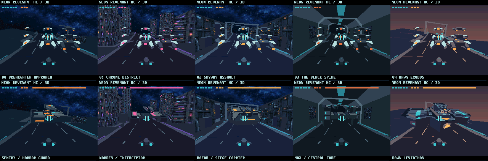

# NEON REVENANT HC / Geo3D v0.3.0 — Geo3D v2.0専用テスト版

**開発・評価用 TEST RELEASE。Geo3D v2.0（1024エントリ構成）専用です。従来のGeo3Dでは動作しません。** ゲームのバージョンはv0.3.0、必要なGeo3Dエンジンはv2.0です。従来環境向けの[ゲームv0.2.0](../v9968-geo3d/README.md)も引き続き利用できます。

MSX turbo R＋V9968＋Geo3D。4 MiB ASCII16 ROM、256色、全5区域・ボス、MSX-MUSIC BGM＋PSG効果音。絵・ゲーム内容を保持し、モデルをGeo3D内に保持して転送を削減しました。

[ROM・パッケージ・動画](https://github.com/kanon-ai/NEON_REVENANT/releases/tag/geo3d-v2-test-v0.3.0)

## 必要環境と起動

検証環境はAlex Moncks氏の[openMSX geo3d-v2.0ブランチ](https://github.com/alexmoncks/openMSX/tree/67811936bee936c15e3fbdbdffe01755fd349876)、コミット`67811936bee936c15e3fbdbdffe01755fd349876`です。Geo3D ID=0x20、XCTRL上位=0xA（1024エントリ）。**作者の開発版v2.0向けです。HRA氏の従来公式配布v1.0とは別です。**

2026年10月15日時点、このopenMSXでのみ検証。実機・FPGA・blueMSX Plus・外付け88h構成は未検証です。従来版でのblueMSX検証結果は本版には適用しません。エミュレータ・BIOS・FPGAファイルは同梱しません。

対応するopenMSX、shareデータ、BIOSを用意し、`OPENMSX_EXE`に実行ファイルを指定して`run-v2.cmd`を起動してください。必要に応じて`OPENMSX_SYSTEM_DATA`も指定します。

```text
openmsx.exe -machine Panasonic_FS-A1ST_V9968 -ext geo3d -cart outputs/NEON_REVENANT-HC-Geo3D-v2-test-v0.3.0.rom -romtype ASCII16 -script interactive.tcl
```

SPACE：開始・射撃・再挑戦、矢印：移動、X：NOVA、ESC：ポーズ／再開。ポーズ中も走行演出は続きます。

## 性能と検証

同じカメラ経路・80画面更新、通常戦は敵9機固定で比較したエミュレータ上の値です。全編平均FPS・実機速度ではありません。フレーム間引きや動画の倍速化はありません。

| 面 | 通常戦 更新/秒：従来→本版 | ボス戦 更新/秒：従来→本版 |
|---|---:|---:|
| 00 | 15.62 → 19.98 | 19.82 → 23.37 |
| 01 | 12.08 → 13.97 | 13.55 → 16.70 |
| 02 | 13.43 → 17.31 | 17.32 → 17.31 |
| 03 | 13.43 → 17.31 | 17.32 → 17.31 |
| 04 | 14.98 → 17.96 | 17.32 → 18.88 |

通常戦約16–29％改善、ボス戦ほぼ同等～約23％改善。新機能を使用するゲーム側の転送削減による比較です。[測定データ](verification/performance.json)。実機での改善率を保証するものではありません。

5面×通常／ボス×3時点の30画像は従来版と表示VRAMが一致。移動、射撃、NOVA、ポーズ、音源出力、全5面からクリアへの遷移を確認しました。遷移試験はタイマー・HP・シールドを操作した短縮条件で、手操作による全編クリアではありません。[検証記録](verification)。



## 再ビルド

Python 3とSDCC（検証4.6.0）が必要です。`SDCC_BIN`でbinフォルダーを指定するかSDCCをPATHへ設定し、`python build_variant.py`を実行します。`baseline/game.rom`のv0.2.0資源を保持してC/ASMとモデル形式を更新し、`out/NEON_REVENANT-HC-Geo3D-v2-resident-test.rom`を生成します。基礎資源の生成ソースは[従来版](../v9968-geo3d)にあります。

[著作権](COPYRIGHT.md)・[免責事項](DISCLAIMER.md)・[第三者ライセンス](THIRD_PARTY_NOTICES.md)。試作ソフトとして無保証で提供します。

## English

**v0.3.0 TEST RELEASE, exclusively for the development Geo3D v2.0 engine with 1024 entries. Not compatible with Geo3D v1.0.** The previous game v0.2.0 remains available. 4 MiB ASCII16, turbo R + V9968 + Geo3D, five sectors, 256-color textures, MSX-MUSIC and PSG.

Resident model storage reduces CPU transfers while preserving artwork and gameplay. Controlled emulator scenarios improved normal combat by approximately 16–29%; boss scenes were effectively unchanged to approximately 23% faster. These are not whole-game averages or hardware measurements. Tested only with the linked author's openMSX v2 development commit. Hardware, FPGA, blueMSX Plus and external 88h configuration are untested for this edition. No emulator, BIOS or FPGA files are bundled.
